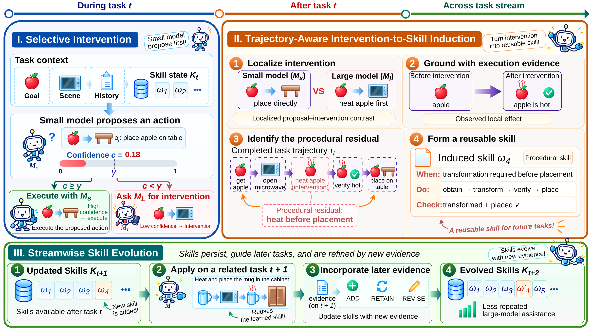

<a name="readme-top"></a>

<div align="center">
  
  <h1>From Intervention to Skill: Evolving Small–Large Language Model Collaboration</h1>
  <a href="https://modalitydance.github.io/I2S/">
    
  </a>
  <a href="#citation" title="arXiv link to be added at publication">
    
  </a>
  <a href="#citation" title="Hugging Face Paper link to be added at publication">
    
  </a>
  <a href="https://huggingface.co/ModalityDance/I2S-Qwen3-8B-Confidence" title="Planned Hugging Face model repository">
    
  </a>
  <a href="./LICENSE">
    
  </a>
</div>

<a name="overview"></a>

**Intervention-to-Skill (I2S)** turns large-model assistance into procedural skills that a small model can reuse across tasks. The small model proposes an action, a calibrated confidence score guides intervention, and execution feedback supports skill acquisition and refinement. Skills carry over between tasks while the acting models remain fixed.

### 🪐 Key Features

- **Selective collaboration.** Route small-model proposals using calibrated confidence and execution feedback.
- **Reusable procedural skills.** Turn effective interventions into skills with applicability conditions, ordered operations, and outcome checks.
- **Streamwise adaptation.** Carry skills across tasks and refine them with new evidence while the acting models remain fixed.

The implementation supports **ALFWorld**, **WebShop**, and **ScienceWorld**, with local or cloud large-model backends.

<div align="center">
  <a href="./docs/assets/overview.pdf"></a>
  <p><em>From large-model interventions to reusable skills for future tasks.</em></p>
</div>

## 🔥 News

- **[2026.10]** The I2S implementation is available in this repository.

## 📑 Table of Contents

- [Quick Start](#quick-start)
  - [Installation](#installation)
  - [Data & Checkpoints](#data)
  - [Running](#running)
  - [Confidence Calibration](#confidence-calibration)
  - [Evaluation](#evaluation)
- [Usage Example](#usage-example)
- [How It Works](#how-it-works)
- [Acknowledgements](#acknowledgements)
- [Citation](#citation)

<a name="getting-started"></a>

## 🚀 Quick Start <span id="quick-start"></span>

### 1. Installation <span id="installation"></span>

```bash
git clone https://github.com/ModalityDance/I2S.git
cd I2S
conda env create -f environment.yaml
conda activate i2s
python -m pip install -e '.[training]'
```

> [!NOTE]
> Use Linux, Python 3.10, and Java 11. Local model serving and calibration training use CUDA GPUs. Run the commands below from the repository root.

### 2. Data & Checkpoints <span id="data"></span>

Download benchmark assets and build the WebShop search index:

```bash
python scripts/setup_environments.py all --download --build-index
```

The pretrained confidence model is [I2S-Qwen3-8B-Confidence](https://huggingface.co/ModalityDance/I2S-Qwen3-8B-Confidence), a complete checkpoint based on [Qwen3-8B](https://huggingface.co/Qwen/Qwen3-8B). It loads directly with Transformers or vLLM.

> [!NOTE]
> Benchmark assets are stored in `data/`; WebShop source is installed in `third_party/`. Set existing asset paths in [configs/environments.yaml](configs/environments.yaml). `I2S_ENV_PYTHON` selects the environment interpreter, and `JAVA_HOME` selects Java.

### 3. Running <span id="running"></span>

I2S uses Qwen3-8B for action generation and I2S-Qwen3-8B-Confidence for confidence scoring. Choose a large-model backend:

| Backend | Large model | Service |
| --- | --- | --- |
| `local` | Qwen3-32B | vLLM |
| `deepseek` | DeepSeek-V4-Flash | OpenAI-compatible API |
| `gemini` | Gemini-2.5-Flash | OpenAI-compatible API |

Start the small-model service in a serving environment:

```bash
conda create -n i2s-serving python=3.10 -y
conda activate i2s-serving
python -m pip install -e '.[serving]'
CUDA_VISIBLE_DEVICES=0 python scripts/serve_models.py small
```

Start the confidence model in a second terminal:

```bash
conda activate i2s-serving
CUDA_VISIBLE_DEVICES=1 python scripts/serve_models.py confidence
```

For the local backend, start the teacher in another terminal:

```bash
conda activate i2s-serving
CUDA_VISIBLE_DEVICES=2,3 python scripts/serve_models.py large --tensor-parallel-size 2
```

> [!TIP]
> For a cloud teacher, set the endpoint and API key from [.env.example](.env.example), then run with `--backend deepseek` or `--backend gemini`. Adjust GPU assignments and tensor parallelism for your hardware. `I2S_SMALL_MODEL`, `I2S_CONFIDENCE_MODEL`, and `I2S_LARGE_MODEL` select the model weights.

Run one ALFWorld task in the I2S environment:

```bash
conda activate i2s
i2s check
i2s run --benchmark alfworld --tasks 1 --run-id alfworld_run
```

Results are saved under `runs/<run-id>`. Routing uses **γ = 0.99**. Agent, model, and environment settings are in [configs/default.yaml](configs/default.yaml), [configs/models.yaml](configs/models.yaml), and [configs/environments.yaml](configs/environments.yaml).

<details>
<summary>Run all task families and resume a stream</summary>

Each family maintains an independent skill bank; tasks within a family run sequentially.

```bash
i2s run --benchmark alfworld --all-families --run-id alfworld
i2s run --benchmark webshop --all-families --run-id webshop
i2s run --benchmark scienceworld --all-families --run-id scienceworld
```

Resume with the same settings and run ID:

```bash
i2s run --benchmark scienceworld --all-families --run-id scienceworld --resume
```

Inspect the resolved configuration:

```bash
i2s resolve --benchmark alfworld --backend local
```

</details>

### 4. Confidence Calibration <span id="confidence-calibration"></span>

The pretrained confidence model supports all three benchmarks. Confidence scoring normalizes the likelihoods of the complete `UNCERTAIN` and `CONFIDENT` labels.

<details>
<summary>Train a confidence model</summary>

Collect decision contexts from ALFWorld's training split with the model services running:

```bash
i2s run --benchmark alfworld --scenario pick_and_place_simple --tasks 100 \
  --set router.reliability_model_id=qwen3_8b \
  --set policy.learning.skills_enabled=false \
  --set model_pool.models.qwen3_8b.generation.max_input_tokens=8192 \
  --set benchmark.split=train --set benchmark.partition_role=train \
  --run-id reliability_collection
```

Prepare the data, train for three epochs, and export the complete model. Training and validation use disjoint task identities.

> [!NOTE]
> Stop serving processes before training on the same GPUs. Set `I2S_CONFIDENCE_MODEL` in both the serving and I2S terminals to use the exported model.

```bash
python scripts/prepare_reliability_data.py \
  --runs runs/reliability_collection --output data/reliability
CUDA_VISIBLE_DEVICES=0 python scripts/train_reliability.py
python scripts/export_confidence_model.py --output runs/confidence_model
```

Start the trained confidence model:

```bash
conda activate i2s-serving
export I2S_CONFIDENCE_MODEL=runs/confidence_model
CUDA_VISIBLE_DEVICES=1 python scripts/serve_models.py confidence
```

</details>

### 5. Evaluation <span id="evaluation"></span>

Pretrained model: [🤗 ModalityDance/I2S-Qwen3-8B-Confidence](https://huggingface.co/ModalityDance/I2S-Qwen3-8B-Confidence) · [Model files](https://huggingface.co/ModalityDance/I2S-Qwen3-8B-Confidence/tree/main).

Compute benchmark metrics from a saved run:

```bash
conda activate i2s
i2s evaluate runs/alfworld_run
```

Evaluation writes `metrics.json` and `validation.json`, including native task outcomes, interventions, and model usage. Weighted output tokens are **W = L + 0.25S**, where L and S include large- and small-model output tokens, reasoning, and retries.

<details>
<summary>Evaluate a newly trained confidence model</summary>

Use the validation data prepared in Confidence Calibration:

```bash
python scripts/train_reliability.py --evaluate-only \
  --model runs/confidence_model \
  --validation data/reliability/validation.jsonl \
  --output runs/reliability_evaluation
```

</details>

## 🧪 Usage Example <span id="usage-example"></span>

After preparing the data and starting the model services, run one ALFWorld task from Python:

```python
from i2s.config import load_config
from i2s.evaluation import evaluate_run
from i2s.runner import run_experiment

config_path = "configs/default.yaml"
config = load_config(
    config_path,
    benchmark="alfworld",
    backend="local",
    overrides=["benchmark.sample_count=1"],
)
run_dir = run_experiment(config, config_path)
metrics = evaluate_run(run_dir)
print("Success rate:", metrics["success_proportion"])
print("Weighted tokens per task:", metrics["usage"]["weighted_output_tokens_per_task"])
```

## ✨ How It Works <span id="how-it-works"></span>

1. **Selective intervention.** A calibrated confidence score below 0.99 or an execution failure triggers large-model assistance.
2. **Skill induction.** After a task, proposal–intervention contrasts and execution feedback identify reusable procedures.
3. **Skill evolution.** Add, retain, or revise skills using new evidence, then supply them to later small-model decisions.

## 🌱 Acknowledgements <span id="acknowledgements"></span>

We thank the teams behind [Qwen3](https://github.com/QwenLM/Qwen3), [ALFWorld](https://github.com/alfworld/alfworld), [WebShop](https://github.com/princeton-nlp/WebShop), [ScienceWorld](https://github.com/allenai/ScienceWorld), [vLLM](https://github.com/vllm-project/vllm), and [Transformers](https://github.com/huggingface/transformers).

This project is licensed under the [MIT License](LICENSE).

## 📚 Citation <span id="citation"></span>

Please cite our paper as:

```bibtex
@misc{shi2026i2s,
  title  = {From Intervention to Skill: Evolving Small--Large Language Model Collaboration},
  author = {Zhenning Shi and Ran Wei and Ning Song and Yongqi Li},
  year   = {2026},
  url    = {https://github.com/ModalityDance/I2S}
}
```

<div align="center">
  <a href="https://github.com/ModalityDance/I2S">
    
  </a>
  <a href="https://github.com/ModalityDance/I2S/issues">
    
  </a>
</div>
